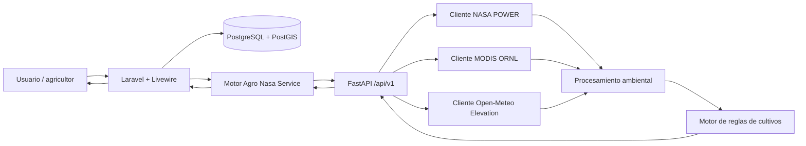

# Earth Simple

Earth Simple es una plataforma orientada al análisis de parcelas agrícolas y a la generación de recomendaciones de cultivos a partir de información ambiental, geoespacial y del historial agronómico del productor.

## A. Nombre y descripción

### Problema que busca resolver

El proyecto intenta apoyar a productores y equipos técnicos en la evaluación de alternativas de rotación de cultivos y uso del suelo, combinando datos proporcionados por el agricultor con observaciones ambientales de escala regional. La idea central es convertir información climática, de vegetación y topográfica en una evaluación útil para comparar opciones de cultivo, sin presentar resultados como predicciones definitivas de rendimiento.

### Objetivo principal

Proveer una herramienta de apoyo a la decisión para:

- analizar una parcela agrícola por coordenadas,
- consultar información ambiental y geoespacial,
- valorar condiciones climáticas y de vegetación,
- comparar cultivos dentro de un catálogo heurístico,
- generar recomendaciones con reglas explicables y advertencias sobre la calidad y cobertura de la evidencia.

### Público objetivo

La solución está orientada principalmente a:

- productores y extensionistas,
- equipos de asesoría agrícola,
- desarrolladores y analistas que revisen decisiones agronómicas y patrones de evaluación.

## B. Características principales

### Implementadas

- Análisis ambiental de parcelas agrícolas por latitud/longitud y rango de fechas.
- Obtención de métricas climáticas diarias y mensuales mediante NASA POWER.
- Obtención de índices de vegetación NDVI y EVI mediante MODIS ORNL.
- Consulta de elevación puntual mediante Open-Meteo.
- Normalización, limpieza y validación de respuestas externas y datos parciales.
- Motor de reglas heurísticas para ranking de cultivos con explicación de reglas activadas.
- Evaluación de información disponible y generación de advertencias cuando faltan datos o la evidencia es insuficiente.

### En desarrollo o pendientes

- Perfiles agronómicos específicos por cultivo, variedad, registro histórico detallado o condiciones locales no validadas directamente.
- Modelos de predicción de rendimiento o rentabilidad financiera.
- Regionalización agronómica más detallada de suelos, climas o municipios.
- Validación agronómica institucional o experimental a mayor escala.

## C. Tecnologías utilizadas

### Frontend y aplicación principal

- Laravel 13.x
- Livewire 3.x
- Tailwind CSS, incorporado a través de Vite y del stack de Laravel

La aplicación Laravel actúa como capa principal de negocio, manejo de sesiones, rutas y vistas de la aplicación web.

### Backend de procesamiento

- Python
- FastAPI
- httpx, pandas, numpy, pydantic-settings

El servicio Python se encarga de la lógica de análisis ambiental y de la comunicación con fuentes externas.

### Base de datos y geoespacial

- PostgreSQL
- PostGIS

El proyecto define esquema espacial en la aplicación Laravel mediante migraciones que crean la extensión PostGIS y columnas geométricas sobre predios. Aunque el ejemplo de entorno de Laravel incluye SQLite por defecto, la implementación geoespacial real del proyecto está pensada para PostgreSQL con PostGIS.

## D. Arquitectura del sistema

La solución está compuesta por dos capas principales:

1. La aplicación web en Laravel, que administra la experiencia de usuario y la lógica de negocio asociada a predios y consultas.
2. El microservicio en Python/FastAPI, que recibe la solicitud y agrega datos climáticos, de vegetación y elevación para producir recomendaciones.



### Flujo real del sistema

- El usuario interactúa con la aplicación en Laravel.
- La aplicación puede persistir predios y resultados en PostgreSQL/PostGIS.
- Laravel envía un paquete de análisis al microservicio FastAPI.
- FastAPI consulta las APIs externas y normaliza la respuesta.
- El motor de reglas genera un ranking de cultivos con advertencias y cobertura de evidencia.
- Laravel recibe la respuesta y la expone al usuario dentro de la aplicación.

## E. Fuentes de datos externas

### NASA POWER

Fuente oficial: https://power.larc.nasa.gov/

Se utiliza para obtener variables climáticas diarias relevantes para agricultura, entre las que el cliente actual consulta:

- T2M: temperatura media (°C)
- T2M_MAX: temperatura máxima (°C)
- T2M_MIN: temperatura mínima (°C)
- PRECTOTCORR: precipitación corregida (mm/día)
- GWETROOT: humedad del suelo en la zona de raíces

Estas variables son transformadas por el servicio Python y luego comparadas con umbrales heurísticos del motor de recomendaciones.

### MODIS ORNL

Fuente oficial: https://modis.ornl.gov/

El cliente actual consulta la serie MOD13Q1 y procesa bandas de vegetación para obtener:

- NDVI
- EVI

La implementación divide el período de análisis en bloques temporales y combina resultados por banda. Los valores se normalizan tras la limpieza y luego se obtienen promedios y observaciones por fecha.

### Open-Meteo Elevation

Fuente oficial: https://open-meteo.com/

Se consulta la API de elevación para obtener un valor puntual `elevation` asociado a la coordenada analizada. Esa variable se usa en el motor de reglas para priorizar un cultivo según el umbral altitudinal existente, sin interpretar esta relación como una validación agronómica definitiva.

### Importante sobre datos externos

Los datos externos son estimaciones u observaciones con resolución y alcance propios. En este proyecto no se asume que sean mediciones de suelo o predicciones de rendimiento. El sistema maneja respuestas parciales y genera advertencias cuando la evidencia es incompleta.

## F. Motor de recomendaciones agrícolas

El archivo principal del motor es `python-api/app/services/reglas_cultivos.py`.

### Catálogo actual de cultivos

El motor trabaja con un catálogo pequeño y explícito:

- Maíz — Poaceae
- Frijol — Fabaceae
- Haba — Fabaceae
- Avena — Poaceae

### Reglas de selección implementadas

El motor aplica reglas heurísticas y no un modelo agronómico calibrado. Algunas de las señales disponibles son:

- precipitación anualizada por período analizado,
- humedad de suelo media,
- índices NDVI/EVI bajos,
- condición de riego reportada,
- elevación de la parcela,
- rotación reciente de familias botánicas.

El proyecto incluye umbrales como:

- `UMBRAL_PRECIPITACION_ANUAL_MM = 500.0`
- `UMBRAL_HUMEDAD_SUELO = 0.25`
- `UMBRAL_NDVI = 0.30`
- `UMBRAL_EVI = 0.20`
- `UMBRAL_ELEVACION_M = 1800.0`

### Influencia de la altitud, disponibilidad de agua y rotación

- Si la elevación supera 1800 m, el motor aplica una preferencia altitudinal para la familia de cultivo asociada.
- Si hay déficit de precipitación o humedad del suelo, y no se reporta riego, se activan reglas heurísticas.
- Si los dos ciclos anuales más recientes son Poaceae, se detecta repetición de familia y se añade una señal de rotación.

### Cómo se calcula el score

El score base del ranking es heurístico y no representa una probabilidad ni una predicción de rendimiento. La lógica actual es:

- base inicial: 50
- +25 si el cultivo coincide con la familia objetivo
- -15 si no coincide con la familia objetivo
- +20 si el cultivo coincide con el cultivo sugerido por umbral altitudinal

Después se aplican factores adicionales según las condiciones del entorno, tipo de cultivo, tipo de riego, fecha de siembra deseada y objetivos del productor.

### Qué representa `confidence_score`

`confidence_score` no es una probabilidad de éxito agronómico. Es un indicador de cobertura de evidencia disponible, construido con reglas del proyecto. La lógica actual pondera:

- clima disponible: 40
- vegetación disponible: 15
- elevación disponible: 15
- historial disponible: 20
- riego conocido: 10

Si no hay evidencia mínima, el sistema devuelve `sufficient_information: false` con recomendaciones vacías.

### Información suficiente

El sistema considera que hay información suficiente si se dispone de al menos una de estas señales:

- precipitación útil o humedad de suelo disponible,
- NDVI/EVI usable,
- o una indicación de rotación con dos ciclos anuales identificados.

### Limitaciones del motor actual

El motor actual es explícitamente heurístico y no equivale a una recomendación agronómica validada. Sus limitaciones relevantes son:

- no reemplaza análisis de suelo,
- no mide fertilidad del suelo ni disponibilidad nutricional real,
- no utiliza perfiles agronómicos específicos por cultivo o región,
- no valida productividad ni rentabilidad,
- no calcula una probabilidad de éxito agronómico.

La documentación de respuesta del proyecto enfatiza este punto y lo expresa en `methodological_limitations`.

## G. Estructura del proyecto

```text
.
├── AGENTS.md
├── docs/
│   ├── design.md
│   └── rules.md
├── earth-simple/                     # Aplicación Laravel principal
│   ├── app/
│   ├── bootstrap/
│   ├── config/
│   ├── database/
│   ├── public/
│   ├── resources/
│   ├── routes/
│   ├── .env.example
│   ├── artisan
│   ├── composer.json
│   ├── package.json
│   ├── vite.config.js
│   └── ...
├── python-api/                       # Servicios FastAPI y análisis ambiental
│   ├── app/
│   │   ├── clients/
│   │   ├── core/
│   │   ├── routers/
│   │   ├── schemas/
│   │   ├── services/
│   │   └── main.py
│   ├── tests/
│   └── .env
├── requirements.txt
├── README.md
└── ...
```

## H. Instalación y configuración

### 1) Requisitos previos

- PHP 8.3+
- Composer
- Node.js y npm
- PostgreSQL con PostGIS habilitado
- Python y pip

### 2) Clonación del repositorio

```bash
git clone <url-del-repositorio>
cd nasa-adapting-farms
```

### 3) Instalación de dependencias de Laravel

```bash
cd earth-simple
composer install
npm install
```

### 4) Configuración de variables de entorno

El proyecto incluye un ejemplo de configuración para Laravel en `earth-simple/.env.example`. Debes crear tu propio `.env` y ajustar los valores locales.

Ejemplo de variables relevantes para la aplicación:

```env
APP_NAME=EarthSimple
APP_ENV=local
APP_KEY=
APP_DEBUG=true
APP_URL=http://localhost:8000
DB_CONNECTION=pgsql
DB_HOST=127.0.0.1
DB_PORT=5432
DB_DATABASE=earth_simple
DB_USERNAME=postgres
DB_PASSWORD=tu_password
AGRO_ENGINE_URL=http://127.0.0.1:8001/api/v1
AGRO_ENGINE_TIMEOUT=25
```

Importante: la plantilla `.env.example` de Laravel puede mostrar SQLite como valor por defecto del proyecto base, pero las migraciones reales del proyecto geoespacial crean PostGIS y dependen de PostgreSQL con extensión activa.

### 5) Configuración de PostgreSQL y PostGIS

En la base de datos de trabajo debe crearse la extensión PostGIS:

```sql
CREATE EXTENSION IF NOT EXISTS postgis;
```

Y luego ejecutar migraciones de Laravel:

```bash
cd earth-simple
php artisan migrate
```

### 6) Instalación de dependencias Python

```bash
cd ../python-api
python3 -m venv .venv
source .venv/bin/activate
pip install -r ../requirements.txt
```

El servicio FastAPI usa `pydantic-settings` para leer un archivo `.env` dentro del directorio `python-api`:

```env
PROJECT_NAME="NASA Agro Engine"
NASA_POWER_URL="https://power.larc.nasa.gov/api/temporal/daily/point"
HTTP_TIMEOUT=20.0
```

### 7) Comunicación entre Laravel y FastAPI

La aplicación Laravel usa la configuración `services.agro_engine` en `earth-simple/config/services.php` con la URL predeterminada:

```env
AGRO_ENGINE_URL=http://127.0.0.1:8001/api/v1
```

La relación real es:

- Laravel compone la solicitud de análisis.
- `MotorAgroNasaService` la envía al endpoint de FastAPI.
- El microservicio procesa el análisis y devuelve un JSON con métricas, advertencias y recomendaciones.

## I. Ejecución del proyecto

### Laravel

```bash
cd earth-simple
php artisan serve --host 0.0.0.0 --port 8000
```

### Vite (frontend assets)

```bash
cd earth-simple
npm run dev -- --host 0.0.0.0
```

### FastAPI

```bash
cd python-api
source .venv/bin/activate
uvicorn app.main:app --host 0.0.0.0 --port 8001 --reload
```

### Verificación rápida

- Laravel: http://localhost:8000
- FastAPI: http://localhost:8001/health

## J. API de análisis

### Endpoint disponible

`POST /api/v1/analysis/climate-preview`

### Propósito

Recibe una solicitud con información de una parcela, rango de fechas, historial de cultivos y, opcionalmente, datos ambientales ya aportados por el usuario.

El servicio intenta completar la información con:

- NASA POWER para clima,
- MODIS ORNL para vegetación,
- Open-Meteo Elevation para altitud.

### Campos principales de la solicitud

La definición exacta se encuentra en `python-api/app/schemas/request_schemas.py` y los principales campos son:

- `latitude`: latitud de la parcela
- `longitude`: longitud de la parcela
- `start_date`: fecha inicial del periodo
- `end_date`: fecha final del periodo
- `area_hectares`: superficie opcional
- `soil_type`: tipo de suelo opcional
- `has_irrigation`: disponibilidad de riego
- `irrigation_type`: tipo de riego si aplica
- `crop_history`: historial agrícola
- `environmental_data`: métricas climáticas, vegetación y elevación ya conocidas

### Ejemplo de petición JSON

```json
{
  "parcel_id": 12,
  "latitude": 19.0414,
  "longitude": -98.2063,
  "area_hectares": 5.5,
  "soil_type": "Franco arcilloso",
  "has_irrigation": false,
  "irrigation_type": null,
  "start_date": "2025-01-01",
  "end_date": "2025-12-31",
  "crop_history": [
    {
      "crop_name": "Maíz",
      "botanical_family": "Poaceae",
      "sowing_date": "2025-05-15",
      "harvest_date": "2025-10-20",
      "yield_tons_per_ha": 4.5,
      "crop_cycle_type": "annual"
    }
  ],
  "desired_sowing_date": "2025-05-15",
  "planting_season": "primavera",
  "production_goal": "comercializacion",
  "environmental_data": {
    "climate_metrics": {
      "avg_temp_c": 18.2,
      "max_temp_c": 31.4,
      "min_temp_c": 6.8,
      "total_precipitation_mm": 650,
      "avg_root_soil_moisture": 0.32
    },
    "vegetation_metrics": {
      "avg_ndvi": 0.41,
      "avg_evi": 0.28,
      "observations": [
        {
          "date": "2025-05-01",
          "ndvi": 0.45,
          "evi": 0.27
        }
      ]
    },
    "elevation_m": 1900
  }
}
```

### Forma general de la respuesta

La respuesta del servicio incluye:

- `parcel_id`
- `coordinates_analyzed`
- `climate_metrics`
- `monthly_series`
- `recommendations`
- `vegetation_metrics`
- `elevation_m`
- `sufficient_information`
- `confidence_score`
- `confidence_level`
- `calculated_indicators`
- `data_warnings`
- `methodological_limitations`

La estructura queda definida en `python-api/app/schemas/response_schemas.py`.

### Manejo de datos parciales y advertencias

El router actual acumula advertencias cuando una fuente falla o cuando los datos están incompletos. El sistema no aborta si falla una fuente ambiental; en su lugar, continúa con los valores disponibles y marca los avisos en `data_warnings`.

## K. Pruebas

Las pruebas actuales están en `python-api/tests/test_recommendaciones.py` y se ejecutan con unittest.

### Comando verificado

```bash
cd nasa-adapting-farms
PYTHONPATH=python-api ./venv/bin/python -m unittest python-api.tests.test_recommendaciones
```

### Casos cubiertos

- validación de datos de entrada y rangos de fechas,
- limpieza de métricas climáticas,
- manejo de fallos en fuentes externas,
- generación de recomendaciones heurísticas,
- soporte para formatos de elevación escalar y lista,
- verificación de la lógica de rechazo cuando la evidencia es insuficiente.

## L. Limitaciones y trabajo futuro

### Limitaciones actuales

- La información depende de la disponibilidad y resolución de APIs externas.
- Datos climáticos y de vegetación pueden ser incompletos o no representar condiciones locales puntuales.
- Los índices NDVI/EVI describen respuesta espectral, no fertilidad ni disponibilidad nutricional real del suelo.
- Las recomendaciones son heurísticas y no sustituyen análisis agronómico validado.
- No existen perfiles agronómicos individualizados y validados para cada cultivo dentro del proyecto actual.
- La recomendación debe interpretarse como apoyo a la decisión, no como predicción de rendimiento.

### Mejoras futuras posibles

- integrar más contexto geográfico y de suelo,
- añadir datos históricos más detallados por parcela,
- mejorar el catálogo de cultivos y sus restricciones,
- incluir validación agronómica con especialistas,
- refinar la seguridad y trazabilidad de las consultas realizadas.

## M. Licencia y contribuciones

Actualmente no existe un archivo de licencia visible en este repositorio. Antes de reutilizar, redistribuir o publicar el proyecto, conviene confirmar con el equipo la licencia aplicable.

### Contribuciones

Las contribuciones pueden realizarse mediante pull requests o revisión del código en el repositorio, siempre verificando que el cambio sea consistente con el estado actual del proyecto y con la arquitectura descrita aquí.

## Uso de herramientas de Inteligencia Artificial

Durante el desarrollo de Earth Simple, el equipo utilizó herramientas de inteligencia artificial como apoyo en las diferentes etapas del proceso de desarrollo, incluyendo la implementación del backend, frontend y diseño de interfaces.

Las herramientas utilizadas fueron:

| Herramienta | Uso durante el desarrollo |
| --- | --- |
| ChatGPT | Apoyo en el análisis de problemas técnicos, diseño de soluciones, revisión de código, explicación de conceptos y orientación sobre arquitectura y buenas prácticas. |
| Google Antigravity | Utilizado como agente de IA para ejecutar tareas de desarrollo en el backend y frontend, analizar el código existente, implementar funcionalidades y apoyar en la resolución de problemas. |
| GitHub Copilot | Utilizado como agente de IA para apoyar la implementación de funcionalidades tanto en el backend como en el frontend, realizar modificaciones en el código y asistir en tareas de desarrollo. |
| Stitch | Utilizado como herramienta de apoyo para la conceptualización, elaboración y exploración visual de interfaces de usuario. |

### Criterio de utilización

Las herramientas de IA se utilizaron como apoyo al trabajo del equipo y no como sustitutos de su participación. El equipo definió los requerimientos, supervisó las tareas ejecutadas por los agentes, revisó las propuestas generadas y fue responsable de las decisiones técnicas, la integración de los componentes y la validación del funcionamiento de la aplicación. También se decidió el stack tecnológico del proyecto por parte del equipo.

## Resumen

Earth Simple es un MVP orientado a la evaluación agronómica de parcelas con apoyo basado en datos ambientales y geoespaciales. El proyecto combina Laravel, PostgreSQL/PostGIS y un servicio FastAPI para consultar NASA POWER, MODIS y Open-Meteo, procesar la información y generar recomendaciones explícitas con advertencias. El enfoque actual es útil como sistema de apoyo a la decisión, pero aún requiere validación agronómica y refinamiento para escenarios reales de producción.
